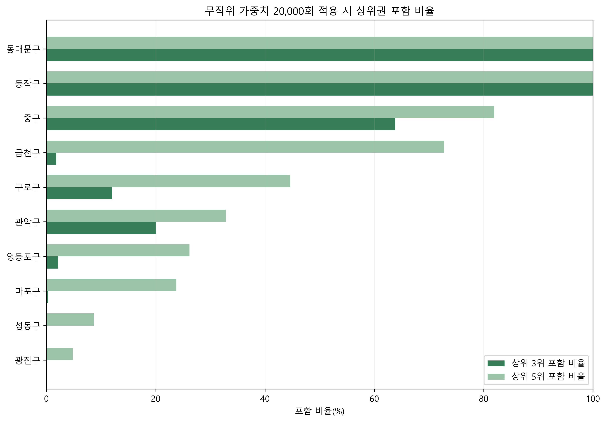

# 가중치 민감도 분석


## 1. 분석 데이터

- 입력 파일: `data/processed/seoul_youth_final_scores_2025.csv`
- 분석 단위: 서울시 25개 자치구
- 사용 영역: 청년집중도점수, 주거비점수, 생활환경점수, 교통점수, 의료점수
- 분석 코드: `src/analysis/analyze_weight_sensitivity.py`
- 그래프 코드: `src/visualization/plot_weight_sensitivity.py`

## 2. 분석 방법

### 2.1 가중치 시나리오 분석

기준 시나리오는 다섯 영역에 각각 20%를 적용한다. 이후 한 영역의 가중치를 30%로 높이고 나머지 네 영역에는 각각 17.5%를 적용하여 영역별 가중치 변화가 상위 순위에 미치는 영향을 비교한다.

| 시나리오 | 청년집중도 | 주거비 | 생활환경 | 교통 | 의료 |
|---|---:|---:|---:|---:|---:|
| 기준 | 20% | 20% | 20% | 20% | 20% |
| 청년집중도 강화 | 30% | 17.5% | 17.5% | 17.5% | 17.5% |
| 주거비 강화 | 17.5% | 30% | 17.5% | 17.5% | 17.5% |
| 생활환경 강화 | 17.5% | 17.5% | 30% | 17.5% | 17.5% |
| 교통 강화 | 17.5% | 17.5% | 17.5% | 30% | 17.5% |
| 의료 강화 | 17.5% | 17.5% | 17.5% | 17.5% | 30% |

### 2.2 무작위 가중치 분석

특정 시나리오만 비교할 때 발생할 수 있는 한계를 보완하기 위해 무작위 가중치 20,000개를 생성하였다.

- 각 영역의 가중치 범위: 10% 이상 30% 이하
- 다섯 영역 가중치의 합: 100%
- 난수 시드: 42
- 반복 횟수: 20,000회
- 확인 항목: 1위 비율, 상위 3위·5위 포함 비율, 하위 5위 포함 비율

## 3. 가중치 시나리오 분석 결과

| 가중치 시나리오 | 1위 | 2위 | 3위 |
|---|---:|---:|---:|
| 기준: 5개 영역 20%씩 | 동대문구 62.4점 | 동작구 60.9점 | 중구 55.4점 |
| 청년집중도 30% | 동작구 63.6점 | 동대문구 63.1점 | 관악구 57.0점 |
| 주거비 30% | 동작구 63.1점 | 동대문구 61.5점 | 구로구 56.1점 |
| 생활환경 30% | 동대문구 63.9점 | 동작구 59.0점 | 중구 55.5점 |
| 교통 30% | 동작구 61.5점 | 동대문구 59.7점 | 중구 58.7점 |
| 의료 30% | 동대문구 63.8점 | 동작구 57.4점 | 중구 54.9점 |


## 4. 무작위 가중치 분석 결과

| 자치구 | 1위 비율 | 상위 3위 포함 | 상위 5위 포함 |
|---|---:|---:|---:|
| 동대문구 | 64.6% | 100.0% | 100.0% |
| 동작구 | 35.4% | 100.0% | 100.0% |
| 중구 | 0.0% | 63.8% | 81.9% |
| 금천구 | 0.0% | 1.8% | 72.8% |
| 구로구 | 0.0% | 12.0% | 44.6% |
| 관악구 | 0.0% | 20.0% | 32.8% |
| 영등포구 | 0.0% | 2.1% | 26.2% |
| 마포구 | 0.0% | 0.3% | 23.8% |
| 광진구 | 0.0% | 0.0% | 8.7% |
| 성동구 | 0.0% | 0.0% | 4.8% |




## 5. 해석 및 결론

동대문구와 동작구는 특정 영역의 가중치가 조금 달라져도 상위권을 유지하므로 최종 결과의 안정성이 높은 지역으로 볼 수 있다. 중구는 전반적으로 상위권에 자주 포함되지만 가중치에 따라 3위 밖으로 밀릴 수 있으며, 금천구·구로구·관악구는 강조하는 영역에 따라 상위권 진입 여부가 달라지는 지역이다.


## 6. 결과 파일

- 시나리오별 결과: `data/processed/weight_sensitivity_scenarios.csv`
- 무작위 가중치 결과: `data/processed/weight_sensitivity_random.csv`
- 결과 그래프: `outputs/charts/weight_sensitivity_frequency.png`

## 7. 실행

프로젝트 폴더에서 분석 코드를 먼저 실행하여 결과 CSV를 생성한다.

```text
python src/analysis/analyze_weight_sensitivity.py
```

이후 생성된 무작위 가중치 결과를 사용하여 그래프를 만든다.

```text
python src/visualization/plot_weight_sensitivity.py
```
