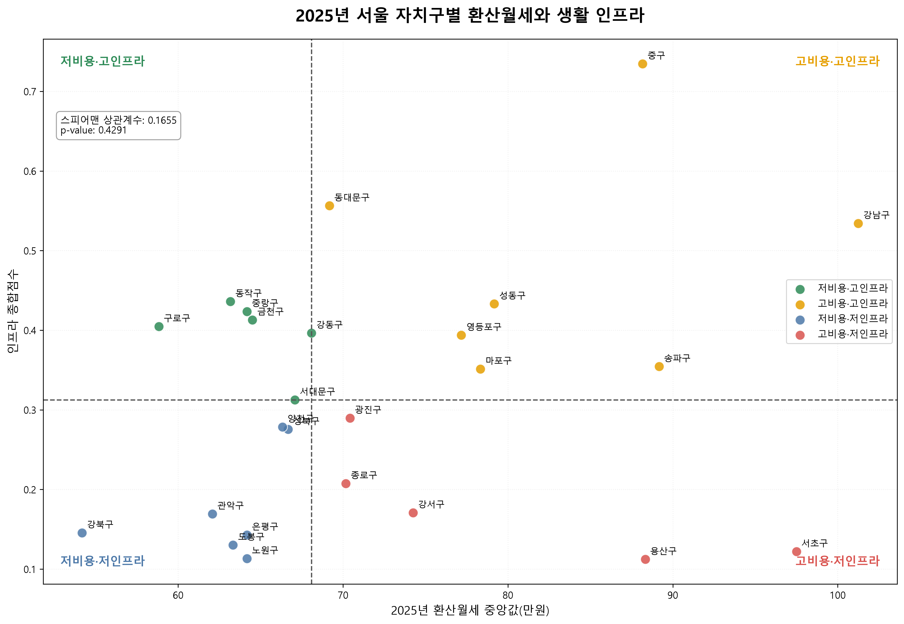

## 1. 분석 데이터

### 입력 파일

```text
data/processed/seoul_youth_final_scores_2025.csv
```

### 분석 단위

- 지역: 서울특별시 25개 자치구
- 기준연도: 2025년
- 자치구 경계 기준일: 2026-07-01

### 사용 변수

| 변수 | 설명 |
|---|---|
| `자치구명` | 서울시 25개 자치구명 |
| `환산월세_2025_만원` | 월세와 보증금을 함께 고려한 자치구별 환산월세 중앙값 |
| `인프라종합점수` | 생활편의·버스·지하철·일상의료·종합의료 지표의 평균 |
| `종합점수_100점` | 9개 정규화 지표를 동일 가중치로 계산한 최종점수 |
| `종합순위` | 최종 종합점수를 기준으로 산출한 순위 |

인프라 종합점수는 다음 5개 정규화 지표의 평균으로 계산하였다.

```text
인프라종합점수 =
(
생활편의시설수_정규화
+ 버스정류소수_정규화
+ 물리적_역수_정규화
+ 일상의료시설수_정규화
+ 종합의료시설수_정규화
) ÷ 5
```

시설 지표는 자치구별 단순 시설 수가 아니라 자치구 면적 1㎢당 시설 수를 기준으로 정규화한 값이다.

---

## 2. 분석 방법

### 2.1 영역 구분 기준

환산월세와 인프라 종합점수의 중앙값을 기준으로 서울 25개 자치구를 네 영역으로 구분하였다.

| 기준 | 중앙값 |
|---|---:|
| 2025년 환산월세 | 68.08만 원 |
| 인프라 종합점수 | 0.31256 |

평균은 일부 극단적인 지역의 영향을 받을 수 있으므로 중앙값을 사용하였다.

분류 기준은 다음과 같다.

| 분류 | 환산월세 | 인프라 종합점수 |
|---|---|---|
| 저비용·고인프라 | 월세 중앙값 이하 | 인프라 중앙값 이상 |
| 고비용·고인프라 | 월세 중앙값 초과 | 인프라 중앙값 이상 |
| 저비용·저인프라 | 월세 중앙값 이하 | 인프라 중앙값 미만 |
| 고비용·저인프라 | 월세 중앙값 초과 | 인프라 중앙값 미만 |

중앙값과 동일한 값은 저비용 또는 고인프라 영역에 포함하였다.

### 2.2 상관분석

환산월세와 인프라 종합점수 사이의 단조 관계를 확인하기 위해 스피어맨 순위상관계수를 사용하였다.

- X 변수: `환산월세_2025_만원`
- Y 변수: `인프라종합점수`
- 분석 대상: 서울 25개 자치구
- 유의수준: 0.05

---

## 3. 영역별 분석 결과

### 3.1 영역별 자치구 수

| 분류 | 자치구 수 |
|---|---:|
| 저비용·고인프라 | 6개 |
| 고비용·고인프라 | 7개 |
| 저비용·저인프라 | 7개 |
| 고비용·저인프라 | 5개 |
| 합계 | 25개 |

---

## 4. 저비용·고인프라 지역

저비용·고인프라 영역은 2025년 환산월세가 서울 자치구 중앙값 이하이면서 인프라 종합점수가 중앙값 이상인 지역이다.

| 자치구 | 환산월세(만원) | 인프라 종합점수 | 종합점수 | 종합순위 |
|---|---:|---:|---:|---:|
| 동작구 | 63.17 | 0.4360 | 58.51 | 2 |
| 구로구 | 58.83 | 0.4047 | 53.31 | 4 |
| 금천구 | 64.50 | 0.4130 | 52.40 | 5 |
| 서대문구 | 67.08 | 0.3126 | 47.37 | 9 |
| 중랑구 | 64.17 | 0.4236 | 47.01 | 11 |
| 강동구 | 68.08 | 0.3965 | 44.85 | 14 |

동작구는 환산월세가 63.17만 원으로 중앙값보다 낮고 인프라 종합점수는 0.4360으로 중앙값보다 높다. 최종 종합순위도 2위로 나타나 주거비와 인프라뿐 아니라 청년 집중도와 교통 조건 등을 함께 고려했을 때도 높은 평가를 받았다.

구로구는 환산월세가 58.83만 원으로 여섯 지역 중 가장 낮으면서 인프라 종합점수는 0.4047이다. 최종 종합순위도 4위로 나타나 상대적으로 저렴한 주거비와 생활 인프라가 결합된 지역으로 해석할 수 있다.

금천구는 환산월세 64.50만 원, 인프라 종합점수 0.4130으로 분류되었으며 최종 종합순위는 5위다.

따라서 동작구·구로구·금천구는 저비용·고인프라 영역에 속하면서 최종 종합순위도 5위 이내인 주요 후보 지역으로 볼 수 있다.

다만 본 분류는 서울 25개 자치구 사이의 상대적인 비교이므로 해당 지역의 월세가 절대적으로 저렴하거나 모든 생활 여건이 우수하다는 의미는 아니다.

---

## 5. 고비용·고인프라 지역

| 자치구 | 환산월세(만원) | 인프라 종합점수 | 종합점수 | 종합순위 |
|---|---:|---:|---:|---:|
| 동대문구 | 69.17 | 0.5564 | 61.79 | 1 |
| 중구 | 88.17 | 0.7346 | 55.76 | 3 |
| 성동구 | 79.17 | 0.4331 | 49.01 | 6 |
| 마포구 | 78.33 | 0.3513 | 48.35 | 7 |
| 영등포구 | 77.17 | 0.3937 | 48.29 | 8 |
| 강남구 | 101.25 | 0.5343 | 43.54 | 15 |
| 송파구 | 89.17 | 0.3544 | 41.18 | 17 |

중구와 강남구는 높은 환산월세에도 불구하고 인프라 종합점수가 높게 나타났다. 이는 일부 고비용 지역에서 인프라 수준도 높게 나타날 수 있음을 보여준다.

그러나 강남구는 인프라 종합점수가 0.5343으로 높지만 환산월세가 101.25만 원으로 서울 25개 자치구 중 가장 높아 최종 종합순위는 15위에 머물렀다.

동대문구는 환산월세가 중앙값을 조금 초과하지만 인프라 종합점수가 0.5564로 높고 다른 지표에서도 비교적 고른 평가를 받아 최종 종합순위 1위를 기록하였다.

---

## 6. 저비용·저인프라 지역

| 자치구 | 환산월세(만원) | 인프라 종합점수 | 종합점수 | 종합순위 |
|---|---:|---:|---:|---:|
| 성북구 | 66.67 | 0.2755 | 46.22 | 12 |
| 관악구 | 62.08 | 0.1693 | 45.42 | 13 |
| 양천구 | 66.33 | 0.2784 | 38.02 | 18 |
| 강북구 | 54.17 | 0.1456 | 37.71 | 19 |
| 노원구 | 64.17 | 0.1132 | 34.41 | 21 |
| 은평구 | 64.17 | 0.1430 | 33.98 | 22 |
| 도봉구 | 63.33 | 0.1302 | 32.07 | 23 |

강북구는 환산월세가 54.17만 원으로 가장 낮지만 인프라 종합점수도 0.1456으로 낮다. 이는 월세가 저렴하다는 이유만으로 생활 인프라까지 우수하다고 판단할 수 없음을 보여준다.

관악구 역시 환산월세는 낮지만 인프라 종합점수가 0.1693으로 낮게 나타났다. 관악구는 청년 1인가구 집중도가 높다는 장점이 있지만, 본 분석에서 측정한 생활·교통·의료 인프라는 상대적으로 낮게 평가되었다.

---

## 7. 고비용·저인프라 지역

| 자치구 | 환산월세(만원) | 인프라 종합점수 | 종합점수 | 종합순위 |
|---|---:|---:|---:|---:|
| 광진구 | 70.42 | 0.2896 | 47.01 | 10 |
| 종로구 | 70.17 | 0.2075 | 41.88 | 16 |
| 강서구 | 74.25 | 0.1708 | 35.11 | 20 |
| 서초구 | 97.50 | 0.1220 | 24.99 | 24 |
| 용산구 | 88.33 | 0.1122 | 18.80 | 25 |

고비용·저인프라 영역은 환산월세가 중앙값보다 높으면서 인프라 종합점수는 중앙값보다 낮은 지역이다.

서초구는 환산월세가 97.50만 원으로 높지만 인프라 종합점수는 0.1220으로 낮아 최종 종합순위 24위를 기록하였다.

용산구 역시 환산월세가 88.33만 원으로 높고 인프라 종합점수는 0.1122로 가장 낮은 수준이며 최종 종합순위는 25위다.

이 결과는 높은 주거비가 반드시 본 분석에서 측정한 생활 인프라의 우수성을 보장하지 않는다는 점을 보여준다.

---

## 8. 스피어맨 상관분석 결과

환산월세와 인프라 종합점수의 스피어맨 순위상관분석 결과는 다음과 같다.

| 항목 | 결과 |
|---|---:|
| 스피어맨 상관계수 | 0.1655 |
| p-value | 0.4291 |
| 분석 대상 | 25개 자치구 |

스피어맨 상관계수는 0.1655로 매우 약한 양의 방향을 보였다. 그러나 p-value가 0.4291로 일반적인 유의수준 0.05보다 높게 나타났다.

따라서 환산월세가 높은 지역일수록 생활 인프라가 우수하다는 통계적으로 유의한 관계는 확인되지 않았다.

이 결과는 두 변수 사이에 관계가 전혀 없다는 사실을 증명하는 것은 아니다. 서울 25개 자치구 자료만으로는 두 변수 사이의 일관된 관계를 판단하기 어렵다는 의미다.

---

## 9. 연구 질문에 대한 해석

분석 결과 일부 고비용 지역은 높은 인프라 수준을 보였지만, 모든 고비용 지역에서 인프라 수준이 높게 나타나지는 않았다.

- 중구·강남구는 고비용·고인프라로 분류되었다.
- 서초구·용산구는 고비용·저인프라로 분류되었다.
- 동작구·구로구·금천구는 저비용·고인프라로 분류되었다.
- 강북구·노원구·도봉구는 저비용·저인프라로 분류되었다.

스피어맨 상관분석에서도 통계적으로 유의한 관계가 확인되지 않았다.

따라서 높은 주거비만으로 생활 인프라 수준을 설명하기는 어려우며, 청년 1인가구에게 상대적으로 살기 좋은 지역을 판단할 때는 월세와 생활 인프라를 함께 고려할 필요가 있다.

---

## 10. 시각화



그래프에서 X축은 2025년 환산월세 중앙값, Y축은 인프라 종합점수를 나타낸다.

수직선은 환산월세 중앙값인 68.08만 원, 수평선은 인프라 종합점수 중앙값인 0.31256을 나타낸다.

왼쪽 위 영역은 저비용·고인프라, 오른쪽 위는 고비용·고인프라, 왼쪽 아래는 저비용·저인프라, 오른쪽 아래는 고비용·저인프라 지역이다.

---

## 11. 실행 방법

월세·인프라 영역 분류표를 생성.

```text
python src/analysis/create_rent_infrastructure_table.py
```

생성된 분류표를 사용해 그래프를 제작.

```text
python src/visualization/plot_rent_infrastructure.py
```

### 생성 파일

```text
data/processed/rent_infrastructure_quadrants_2025.csv
outputs/charts/rent_infrastructure_quadrant.png
```

---

## 12. 결론

2025년 서울 25개 자치구의 환산월세와 인프라 종합점수를 함께 비교한 결과, 동작구·구로구·금천구·서대문구·중랑구·강동구가 저비용·고인프라 영역으로 분류되었다.

이 가운데 동작구·구로구·금천구는 최종 종합순위도 5위 이내로 나타나 청년 1인가구에게 주거비와 생활 인프라의 균형이 상대적으로 양호한 주요 후보 지역으로 볼 수 있다.

반면 서초구와 용산구는 높은 환산월세에도 인프라 종합점수가 낮게 나타났다.

스피어맨 상관분석에서도 환산월세와 인프라 종합점수 사이에 통계적으로 유의한 관계가 확인되지 않았다.

따라서 청년 1인가구에게 살기 좋은 지역을 판단할 때는 단순히 주거비가 높거나 낮다는 사실만으로 결론을 내리기보다 주거비, 생활 인프라, 청년 집중도 및 월세 변화 등을 함께 고려해야 한다.