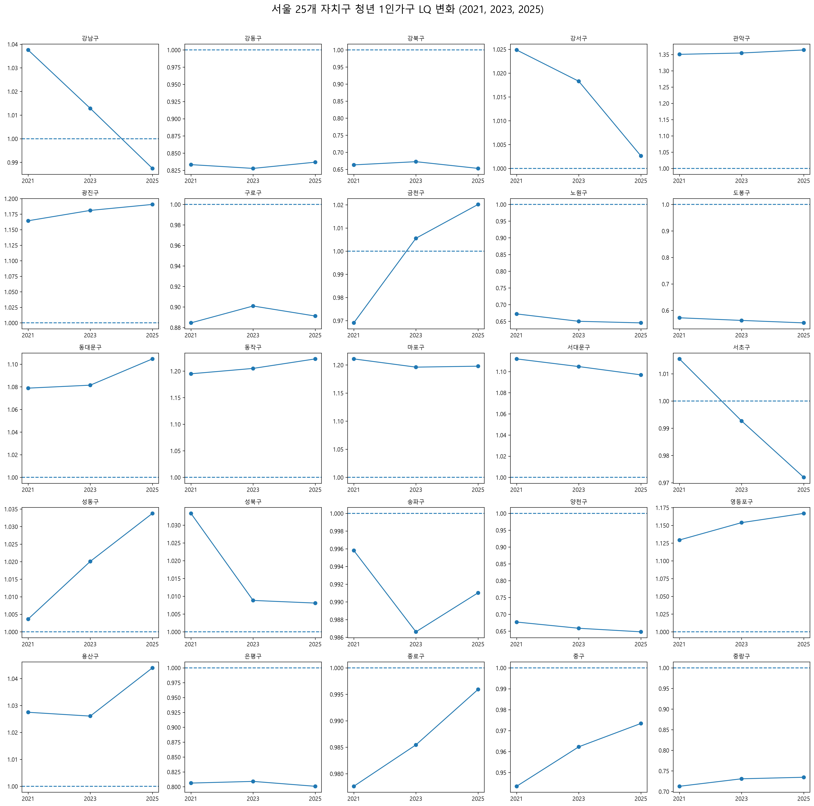
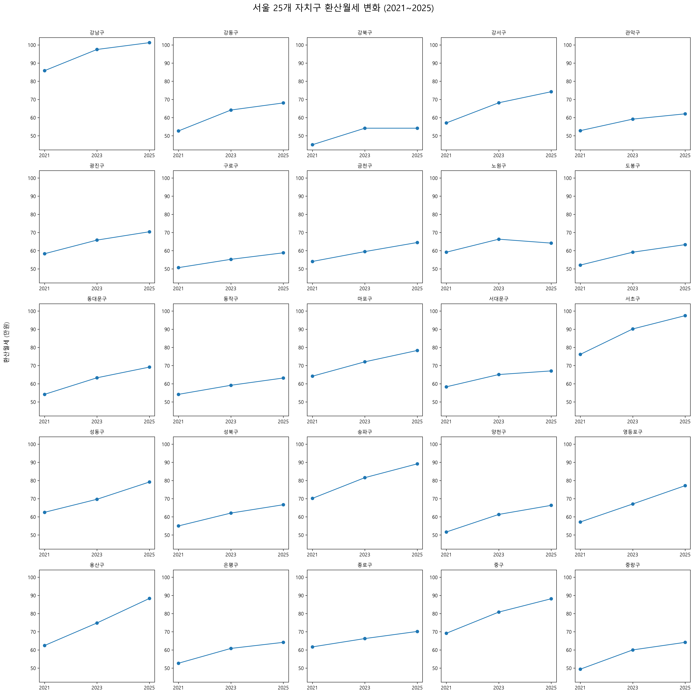

# 서울시 청년 1인가구 LQ 및 환산월세 변화 분석

## 1. 분석 개요

본 분석은 2021년, 2023년, 2025년 서울특별시 25개 자치구의
청년 1인가구 LQ와 환산월세 변화를 비교하기 위해 수행하였다.

청년 1인가구의 상대적 집중도 변화와 주거비 상승 양상을 파악하고,
두 지표 사이에 어떤 관계가 존재하는지 분석하였다.

### 분석 기준

- 분석 지역: 서울특별시 25개 자치구
- 분석 연도: 2021년, 2023년, 2025년
- 청년 연령: 20~39세
- 청년 1인가구 지표: 정규화하지 않은 LQ
- 주거비 지표: 자치구별 환산월세 중앙값(만원)
- 분석 방법: 시계열 비교, 변화량 분석, 피어슨 상관분석

## 2. 청년 1인가구 LQ 변화 분석
### 2.2 LQ 증가 상위 5개 자치구

| 자치구 | 2021년 LQ | 2025년 LQ | 변화량 |
|---|---:|---:|---:|
| 금천구 | 0.9691 | 1.0202 | +0.0511 |
| 영등포구 | 1.1294 | 1.1669 | +0.0375 |
| 성동구 | 1.0036 | 1.0338 | +0.0301 |
| 중구 | 0.9434 | 0.9734 | +0.0300 |
| 동작구 | 1.1949 | 1.2230 | +0.0280 |

### 2.3 LQ 감소 상위 5개 자치구

| 자치구 | 2021년 LQ | 2025년 LQ | 변화량 |
|---|---:|---:|---:|
| 강남구 | 1.0376 | 0.9874 | -0.0501 |
| 서초구 | 1.0155 | 0.9720 | -0.0435 |
| 양천구 | 0.6771 | 0.6480 | -0.0290 |
| 노원구 | 0.6723 | 0.6455 | -0.0268 |
| 성북구 | 1.0333 | 1.0081 | -0.0252 |

### 2.4 분석 결과 해석

2021년부터 2025년까지 청년 1인가구 LQ가 가장 많이 증가한 지역은
금천구(+0.0511)였으며, 영등포구(+0.0375), 성동구(+0.0301)가 뒤를 이었다.

특히 금천구는 LQ가 0.9691에서 1.0202로 증가하면서
서울시 평균보다 낮은 수준에서 높은 수준으로 전환되었다.

반면 강남구는 LQ가 1.0376에서 0.9874로 감소하여
가장 큰 하락 폭(-0.0501)을 기록하였다.
서초구 역시 1.0155에서 0.9720으로 하락하였다.

이러한 결과는 청년 1인가구의 상대적 집중도가 자치구별로
서로 다른 방향으로 변화하고 있음을 보여준다.

다만 LQ 감소가 해당 지역의 청년 1인가구 수 자체의 감소를
의미하는 것은 아니다. 서울시 전체와 비교한 상대적 비중의
변화라는 점에서 해석에 주의가 필요하다.

### 2.5 청년 1인가구 LQ 변화 시각화

## 3. 환산월세 변화 분석

### 3.1 분석 지표

환산월세는 월세와 보증금을 월 단위 주거비로 환산한 값을 합산한 지표이다.
본 분석에서는 기존 전처리 코드에서 산출한 자치구별 환산월세 중앙값을 사용하였다.

2021년, 2023년, 2025년의 환산월세를 비교하여
서울 25개 자치구의 주거비 변화 양상을 분석하였다.

- 변화액(만원): 2025년 환산월세 - 2021년 환산월세
- 변화율(%): (변화액 / 2021년 환산월세) × 100

### 3.2 환산월세 증가액 상위 5개 자치구

| 자치구 | 2021년(만원) | 2025년(만원) | 증가액(만원) | 증가율(%) |
|---|---:|---:|---:|---:|
| 용산구 | 62.42 | 88.33 | 25.91 | 41.51 |
| 서초구 | 76.17 | 97.50 | 21.33 | 28.00 |
| 영등포구 | 57.17 | 77.17 | 20.00 | 34.98 |
| 송파구 | 70.17 | 89.17 | 19.00 | 27.08 |
| 중구 | 69.17 | 88.17 | 19.00 | 27.47 |

### 3.3 환산월세 증가액 하위 5개 자치구

| 자치구 | 2021년(만원) | 2025년(만원) | 증가액(만원) | 증가율(%) |
|---|---:|---:|---:|---:|
| 동작구 | 54.17 | 63.17 | 9.00 | 16.61 |
| 서대문구 | 58.33 | 67.08 | 8.75 | 15.00 |
| 종로구 | 61.67 | 70.17 | 8.50 | 13.78 |
| 구로구 | 50.67 | 58.83 | 8.16 | 16.10 |
| 노원구 | 59.17 | 64.17 | 5.00 | 8.45 |

### 3.4 분석 결과 해석

2021년부터 2025년까지 환산월세 증가액이 가장 큰 자치구는
용산구로, 62.42만 원에서 88.33만 원으로 25.91만 원 상승하였다.
증가율은 41.51%로 나타났다.

서초구는 21.33만 원, 영등포구는 20.00만 원 상승하면서
용산구 다음으로 큰 증가액을 기록하였다.

반면 노원구는 59.17만 원에서 64.17만 원으로 5.00만 원 상승하여
가장 작은 증가액을 기록하였다. 증가율 역시 8.45%로 낮았다.

이처럼 같은 기간에도 자치구별 환산월세 상승 폭에는
차이가 나타났다. 이는 서울시 내 주거비 변화가 모든 지역에서
동일한 수준으로 발생하지 않았음을 보여준다.

다만 환산월세 중앙값의 변화에는 실제 임대료 변화뿐 아니라
연도별 거래 주택의 면적, 유형, 지역별 거래 구성 차이 등이
영향을 미칠 수 있으므로 해석에 주의해야 한다.

### 3.5 환산월세 변화 시각화

## 4. 청년 1인가구 LQ와 환산월세의 관계 분석

### 4.1 분석 방법

서울 25개 자치구를 대상으로 2021년부터 2025년까지
청년 1인가구 LQ 변화량과 환산월세 상승률의 관계를 분석하였다.

두 변수 사이의 선형 관계를 확인하기 위해
피어슨 상관계수(Pearson Correlation Coefficient)를 사용하였다.

- X 변수: 청년 1인가구 LQ 변화량 (2025년 - 2021년)
- Y 변수: 환산월세 상승률 (2021~2025년)
- 분석 대상: 서울특별시 25개 자치구

### 4.2 상관관계 분석 결과

청년 1인가구 LQ 변화량과 환산월세 상승률 사이의
피어슨 상관계수는 0.1898로 나타났다.

이는 두 지표 사이에 약한 양의 선형 상관관계가
존재한다는 것을 의미한다.

그러나 상관계수가 0에 가까운 수준이므로,
청년 1인가구의 상대적 집중도가 증가하는 지역에서
환산월세 상승률도 일관되게 높아진다고 보기는 어렵다.

### 4.3 대표 자치구 비교

| 자치구 | LQ 변화량 | 환산월세 상승률 |
|---|---:|---:|
| 영등포구 | +0.0375 | 34.98% |
| 용산구 | +0.0165 | 41.51% |
| 서초구 | -0.0435 | 28.00% |
| 강남구 | -0.0501 | 17.97% |

영등포구는 청년 1인가구 LQ가 증가하면서
환산월세도 34.98% 상승하였다.

용산구 역시 LQ가 증가하였으며,
환산월세 상승률은 41.51%로 높게 나타났다.

반면 서초구는 LQ가 감소하였음에도
환산월세가 28.00% 상승하였다.

강남구도 LQ가 감소한 반면,
환산월세는 17.97% 상승하였다.

이처럼 환산월세가 상승하는 상황에서도
청년 1인가구의 상대적 집중도는 자치구에 따라
증가하거나 감소하는 상이한 양상을 보였다.

## 5. 종합 결론 및 한계

2021년부터 2025년까지 서울 25개 자치구의
청년 1인가구 LQ와 환산월세 변화를 분석한 결과,
지역별로 서로 다른 변화 양상이 확인되었다.

청년 1인가구 LQ는 금천구와 영등포구에서
상대적으로 크게 증가하였으며,
강남구와 서초구에서는 감소하였다.

환산월세는 용산구와 서초구에서 큰 증가액을 보였고,
노원구에서는 상대적으로 작은 증가액을 기록하였다.

두 지표 사이의 피어슨 상관계수는 0.1898로,
약한 양의 선형 상관관계가 나타났다.

따라서 본 분석 결과만으로 청년 1인가구의
상대적 집중도 변화와 환산월세 상승 사이에
뚜렷한 관계가 있다고 단정하기는 어렵다.

또한 본 분석은 자치구 단위의 집계자료를 사용했으며,
주택 유형, 거래 면적, 교통 접근성 및 생활 인프라 등의
요인을 통제하지 않았다는 한계가 있다.

향후 이러한 요인을 추가로 고려한다면
청년 1인가구의 지역별 집중도와 주거비 사이의
관계를 더욱 구체적으로 분석할 수 있을 것이다.